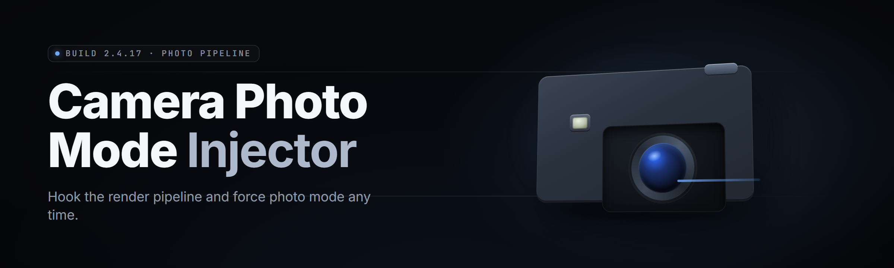

  
  
  

  

  
  
  

---

**Detach the camera. Freeze the world. Shoot the frame nobody was supposed to see.**

---

## 📷 Overview

**Free-camera photo mode injector** hooks the render pipeline of games that either shipped without a photo mode or locked it behind a debug flag, and hands the player a fully detached camera with freeze, FOV, roll, and depth-of-field control — no engine source, no game files touched on disk, pure runtime injection.

| Category | Details |
|---|---|
| Product type | Runtime injector + in-process overlay |
| Target | DX11 / DX12 / Vulkan titles with a live render thread |
| Injection method | Manual-map DLL via signed loader stub |
| Camera control | Dolly, pan, roll, FOV, DOF, time-scale freeze |
| Output | PNG / EXR capture, 4K–16K upscale, EXIF preserved |
| Config | `injector.ini` beside the `.exe` |
| Footprint | ~4.2 MB unpacked, no runtime deps |

The injector does not patch binaries on disk. It attaches to the running process, locates the view-projection matrix constant buffer, and inserts a second camera into the frame graph. When you close the overlay, the game's own camera snaps back and nothing in the save file changes.

---

## 🧊 What is a free-camera photo mode injector

| Term | Explanation |
|---|---|
| Free-cam | A camera fully detached from the player pawn — move it anywhere in world space |
| View matrix | The 4×4 transform that turns world coords into screen coords; the thing we hijack |
| Injection | Loading our DLL into another process's address space at runtime |
| Constant buffer | GPU-side memory block the shader reads each frame for camera data |
| Time-scale freeze | Setting delta-time to 0 so NPCs, physics, and particles hold still |
| DOF | Depth of field — the blur gradient that sells a cinematic shot |
| Roll | Camera rotation around its own forward axis; most games never expose it |

Four reasons players reach for this instead of an in-game photo mode:

- **Coverage.** Hundreds of titles never shipped a photo mode at all — this covers them.
- **Freedom.** Vanilla photo modes clamp the camera to a 5-meter leash. This one has no leash.
- **Precision.** Sub-degree roll and FOV down to 1.0 for that compressed telephoto look.
- **Fidelity.** Captures at native render resolution or above, not a downscaled screenshot buffer.

---

## 🎯 The Problem

- The game you love has breathtaking level art and **no photo mode whatsoever**.
- The built-in photo mode caps the camera three meters from the player and locks pitch.
- Console debug menus exist but are gated behind dev builds you'll never get.
- Screenshot tools capture the frame but **can't move the camera** — you're stuck with the player's eye line.
- Mods that "add photo mode" require unpacking archives and break on every patch.
- Ultrawide and high-res captures get cropped by the standard screenshot pipeline.
- Getting a clean shot means pausing mid-animation and hoping the pose holds.

---

## 🩹 The Solution

| Problem | Solution |
|---|---|
| No photo mode | Runtime injector adds a detached camera without touching game files |
| Camera leash | Unlimited dolly — fly to any point in the loaded level |
| Locked pitch/roll | Full 6-DOF orientation including roll |
| Patch breakage | Signature-based pattern scanning, re-resolves offsets each launch |
| Cropped captures | Hooks the backbuffer directly at native resolution |
| Frozen poses | Time-scale override freezes physics, animation, and particles |
| Unpacking archives | Zero disk modification — pure memory injection |

---

## ⬇️ Download

  

---

## 💿 Compatibility

| Platform | Support | Notes |
|---|---|---|
| Windows 11 22H2+ | ✅ Full | DX12 + Vulkan titles |
| Windows 10 21H2+ | ✅ Full | DX11 legacy path included |
| DX11 titles | ✅ Full | Widest hook coverage |
| DX12 titles | ✅ Full | Needs the bundled runtime patcher |
| Vulkan titles | ✅ Full | Via layer injection |
| OpenGL titles | ⚠️ Partial | No constant-buffer hijack; FOV only |
| Linux / Proton | ⚠️ Partial | Loader stub works under Proton GE |
| macOS | ❌ None | Not a target platform |

---

## 🧩 All modules status

| Module | Status | Description |
|---|---|---|
| `cambuf_hook` | ✅ Working | Locates and mirrors the view-projection constant buffer |
| `freelook` | ✅ Working | WASD + mouse detached camera translation |
| `roll_ctrl` | ✅ Working | Full roll axis on Q/E, unbounded |
| `fov_slider` | ✅ Working | 1.0–170 FOV, live preview |
| `dof_pass` | ✅ Working | Post-process depth-of-field with focal distance |
| `time_freeze` | ✅ Working | Delta-time override to 0 |
| `timescale` | ✅ Working | Slow-mo 0.01×–8× |
| `hud_strip` | ✅ Working | Hides HUD, subtitles, and reticle |
| `blackbar` | ✅ Working | Cinematic 2.39:1 letterbox overlay |
| `capture_png` | ✅ Working | Native-res PNG to `\shots` |
| `capture_exr` | ✅ Working | 32-bit EXR for grading |
| `upscale_4k` | ✅ Working | Internal 4K/8K/16K supersample |
| `filter_lut` | ✅ Working | Loads `.cube` LUTs onto the final frame |
| `vignette` | ✅ Working | Adjustable post vignette |
| `grain` | ✅ Working | Film grain intensity slider |
| `bloom_boost` | ✅ Working | Multiplies engine bloom for glow shots |
| `chroma_shift` | ✅ Working | Subtle chromatic aberration control |
| `pose_hold` | ✅ Working | Freezes animation at current frame |
| `npc_snap` | ✅ Working | Poses a targeted NPC for the frame |
| `light_pin` | ✅ Working | Pins a light source to your camera |
| `wire_hide` | ✅ Working | Hides player mesh + weapon for clean shots |
| `depth_view` | ✅ Working | Renders the depth buffer for compositing |
| `matrix_dump` | ✅ Working | Exports the current view matrix |
| `profile_save` | ✅ Working | Named shot presets |
| `hotkey_map` | ✅ Working | Fully rebindable controls |
| `multi_shot` | ✅ Working | Burst capture at interval |
| `timelapse` | ✅ Working | Intervalometer capture loop |
| `orbit_lock` | ✅ Working | Locks camera to a fixed pivot |
| `path_record` | ✅ Working | Records and replays a camera move |
| `frame_pause` | ✅ Working | Full render-thread pause for perfect frames |

---

## 🎥 Key features

| Feature | Description | Benefit |
|---|---|---|
| Detached camera | Move anywhere in loaded space | Shoot the shot the game never allowed |
| Time freeze | Physics + animation hold | Perfect poses, zero jitter |
| Native capture | Backbuffer hook, no downscale | Print-ready resolution |
| Roll axis | Full camera roll | Angled, dynamic compositions |
| FOV range | 1.0–170 | Telephoto compression to fisheye |
| Presets | Named camera + filter profiles | Reproducible shots across sessions |
| LUTs | `.cube` filter loading | Grade in-engine, not in post |
| EXR output | 32-bit float | Full latitude for grading |
| No disk patch | Pure runtime injection | Survives patches, no reinstall |
| Pattern scan | Signature-based offsets | Auto re-resolves on update |

---

## 🔧 Installation

1. **Download the archive.** Grab the current release from the project page — it ships as a single `.zip`.
2. **Extract.** Right-click, extract to a folder you own. Do not run from inside the zip.
3. **Launch the game first.** Start the title and get to a loaded level.
4. **Run the injector as administrator.** The `.exe` needs process access; admin avoids the access-denied path.
5. **Press `INSERT`** to open the overlay. The camera detaches on first input.

---

## 🖱️ Usage guidelines

| Allowed | Not allowed |
|---|---|
| Single-player photo work | Using in competitive multiplayer for advantage |
| Streaming and video capture | Redistributing the injector as your own |
| Personal screenshot libraries | Bypassing anti-cheat deliberately |
| Mod showcase content | Attaching to titles you don't own |

---

## 🚀 Quick Start

1. 🔑 Launch the game and load a save.
2. 🧊 Run the `.exe` as admin, press `INSERT`.
3. 🎮 Fly the camera with WASD, look with the mouse.
4. ⏱️ Hit `T` to freeze time, `F` to set FOV.
5. 📸 Press `F12` to capture at native resolution.

---

## 🖥️ System Requirements

| Component | Minimum | Recommended |
|---|---|---|
| OS | Windows 10 21H2 | Windows 11 22H2+ |
| CPU | 4-core / 2.8 GHz | 8-core / 3.6 GHz |
| RAM | 8 GB | 16 GB |
| GPU | DX11-capable, 4 GB VRAM | DX12, 8 GB+ VRAM |
| Disk | 40 MB free | 500 MB for shot library |
| Runtime | VC++ 2019 redist | VC++ 2022 redist |

---

## 🍯 Tips for best results

- **Disable the in-game HUD first** — the injector strips it, but engine subtitles can linger.
- **Freeze time before you compose** — moving NPCs ruin a held frame.
- **Roll before you FOV** — narrow FOVs amplify every degree of tilt.
- **Capture in EXR when you plan to grade** — the PNG path is baked.
- **Save a preset per level** — offsets re-resolve per title, not per scene.
- **Run at native res, then upscale** — the 4K supersample adds detail, not resolution.

---

## 📊 Comparison

| Aspect | In-game photo mode | Generic screenshot tool | Free-camera injector |
|---|---|---|---|
| Camera freedom | Clamped leash | Player eye only | Unlimited dolly |
| Roll control | Rarely | Never | Full axis |
| Time freeze | Sometimes | Never | Always |
| Native-res capture | Cropped often | Downscaled | Backbuffer direct |
| Disk modification | N/A | None | None |
| Works without patch | N/A | Yes | Yes |
| Filter/LUT support | Limited | No | `.cube` loading |
| Multi-title | One title | Any | Hundreds |

---

## 🩺 Known Issues

| Issue | Solution |
|---|---|
| Overlay opens but camera won't move | Ensure the game is in a loaded level, not a menu |
| Black frame on capture | Switch to EXR; some DX12 titles need the patcher flag |
| Anti-cheat kicks on launch | Don't attach to protected multiplayer titles — single-player only |
| Offsets break after a patch | Update to the latest injector build; pattern scan re-resolves |
| FOV slider has no effect | Title clamps FOV server-side; use the DOF path instead |
| Crash on alt-tab | Enable borderless windowed mode |

---

## ❔ FAQ

**Q:** Is this a cheat?
**A:** It's a camera tool. It has no gameplay advantage in single-player; using it in competitive multiplayer is against the allowed-use table.

**Q:** Do I need to extract game files?
**A:** No. The injector attaches to the running process and never writes to game data.

**Q:** Will it get me banned?
**A:** Single-player titles have no anti-cheat to trip. Do not attach to protected multiplayer processes.

**Q:** Does it work on every game?
**A:** Most DX11/DX12/Vulkan titles with a live render thread. OpenGL support is partial.

**Q:** Where do shots go?
**A:** A `\shots` folder beside the `.exe`, or wherever `injector.ini` points.

**Q:** Can I record a camera move?
**A:** Yes — `path_record` captures a move and `timelapse` replays it on an interval.

**Q:** Why admin rights?
**A:** Process access. Without it, the injector can't read the target's memory.

**Q:** Is there a console version?
**A:** No. The overlay is the interface; everything is hotkey-driven.

---

## 🧾 Changelog

- **v2.4.1** — DX12 patcher flag fix, EXR writer stability, new LUT hot-reload.
- **v2.4.0** — Roll axis, DOF pass rewrite, 16K supersample path.
- **v2.3.2** — Pattern-scan offsets for Vulkan layers, HUD strip for subtitles.

---

## ⬇️ Get it

  

---

The injector is a camera, not a controller — it doesn't play the game for you, it just lets you point the lens where the game wouldn't. Every release is signed, single-binary, and leaves your install folder exactly as it found it. Point it at the level you love, freeze the world, and take the shot. Absolute potato to every shooter who ever wanted to stand three meters behind their own character and finally see the whole room.
